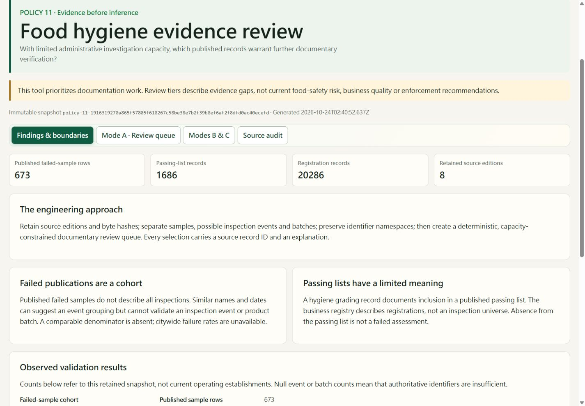
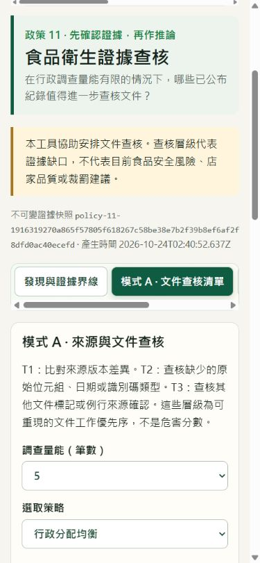

# Policy 11 verification

Verified 24 October 2026, Asia/Taipei. Existing module data and contracts remain unchanged.

| Check | Evidence |
|---|---|
| Baseline | `init.ps1`: production build and original 8 tests passed before edits |
| Source integrity and reproduction | `npm run policy11:verify`: all 8 official response bodies and 3 retained project editions verified; exact generated snapshot and manifest reproduced offline |
| Automated regression suite | `npm test`: 20 passing, including source-schema drift, byte/snapshot tamper rejection, identity exclusions, capacities, sensitivity and CSV injection handling |
| Full CSV | All 22,645 selected IDs survive CSV parsing; full metadata appears once; output is approximately 31 MB |
| Static analysis | `npm run lint`: TypeScript passes |
| Production build | `npm run build`: module has its own lazy JS/CSS chunks; original application bundle warning over 500 kB remains |
| Patch hygiene | `git diff --check`: passes |
| Byte preservation in Git | All 15 evidence-directory files have staged Git blob hashes equal to unfiltered working-file hashes; `.gitattributes` prevents line-ending conversion |
| Browser | Production preview: English/Traditional Chinese switching, 5/10/all capacity, balanced strategy, next-page then reduced-capacity pagination reset, CSV download, Mode B coverage and disabled comparison |
| Downloaded CSV | PowerShell `Import-Csv` reads exactly 5 selected records, `snapshotId` is the first header, file begins with a single UTF-8 BOM |
| Responsive layout | 1440px desktop and 390px mobile inspected; mobile document width 375px within 390px viewport, controls fit; tables/navigation scroll inside their containers |

Independent read-only reviews covered decision semantics, source fidelity, UI/API integration and export/security boundaries. Reported loader path, duplicate BOM, malformed snapshot guard, immutability identity, additive schema, missing bilingual facts and newline defects were corrected before delivery.

## Review images

## Boundaries

No validated physical-establishment associations exist in this evidence edition. Mode B reports 35 name/address candidates but does not admit them. Mode C remains unavailable. Original historical CSVs and their retrieval timestamps cannot be recovered from retained project JSON. No live official endpoint is required for CI or reproduction. Future source refreshes require a new retained edition and explicit schema/identity review. The public dashboard contains no PR or agent handoff content. Portfolio Case Study 011 remains deferred until actual evidence is merged.
