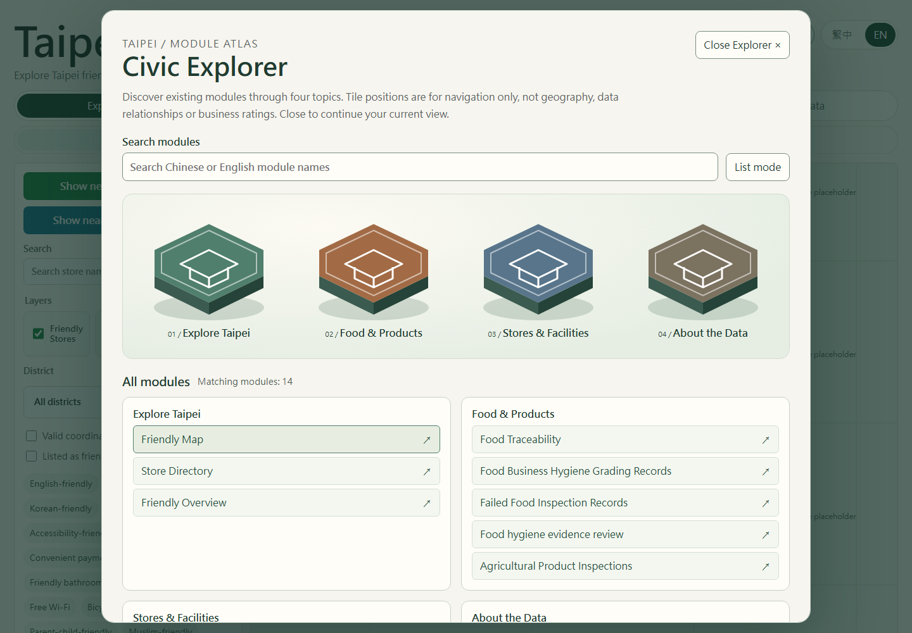
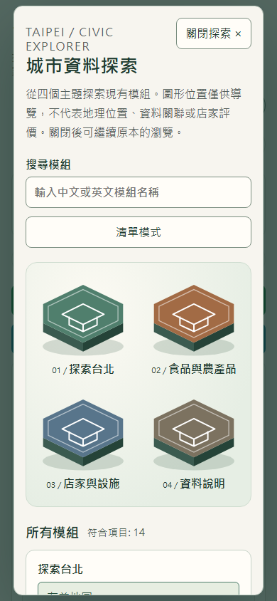

# Civic Explorer verification — 31 October 2026

Optional navigation on isolated branch `codex/civic-explorer`, based on `main` at `ebed7962b8ced05afea285865f95f2bb7e991f1e` (merged Policy 11). Deliver as one Draft PR, without automatic merge.

## Architecture and scope

- `src/data/navigation.ts` is the single typed catalogue for MainTabs and Explorer. Existing IDs, order, category defaults and translation keys are unchanged. MainTabs re-exports TabKey/NavigationGroup for compatibility; its rendering and callbacks are unchanged.
- `ExplorerLauncher.tsx` owns open state, native modal lifecycle, lazy import, loading/error fallback and close. Opening it never updates App state. Its closed dialog contains no Explorer module tree.
- `CivicExplorer.tsx` is the four-group adapter. It searches bilingual existing labels and invokes the same onChange/setActiveTab callback. It does not receive filters, location or source records.
- `explorer/HexHub.tsx` is generic decorative SVG geometry. CSS adds side faces, inset outline, shadow, focus and optional lift; no rendering engine or mandatory package is added.
- App only adds the launcher beside its existing language control. All current modules, map/filter components, data-loading and source rules stay intact. The map is still the initial tab.

## Category-to-tab contract

| Hub / existing group | TabKey destinations |
|---|---|
| Explore Taipei / 探索台北 (`explore`) | `map`, `directory`, `overview` |
| Food & Products / 食品與農產品 (`foodProducts`) | `traceability`, `hygieneGrading`, `failedInspections`, `policy11`, `agriculturalInspections` |
| Stores & Facilities / 店家與設施 (`facilities`) | `commercialDistricts`, `greenStores`, `organicFarms`, `temporaryVendorMarkets`, `supermarkets` |
| About This Data / 資料說明 (`about`) | `notes` |

The existing English translation of the fourth group is **About the Data**; it is deliberately reused in both navigators. Water-refill and registered-business layers remain controls on the map/directory rather than invented destinations. Traditional Markets is not an existing TabKey and is not exposed.

## State and data evidence

`browser-results.json` records all 14 destinations, Chinese/English search and module labels, native dialog naming/keyboard/focus restoration, catalogue/list fallback and source shortcut. Opening/closing preserves district, keyword, minimum friendly-item count, service tags, layer selections, valid-coordinate selection, successful user location and a retained location-denial message. A directory-selected store is focused through the existing mechanism; after settling Leaflet's existing popup auto-pan, the map and marker nodes, selected-store popup text and map-pane transform stay identical. MutationObserver observed **zero removed markers**. Reopening requested **zero resources**.

First opening requested exactly the optional JS and CSS; it triggered no data fetch, map-tile request, Policy 11 preload or geolocation call. The initial page does not load Explorer or Policy 11 chunks. A deliberately blocked Explorer chunk renders a contained alert; the map and original tabs continue working.

`boundary-results.json` verifies all **316 original translation values**, data/loading/matching implementations, module implementations, original conversion scripts, raw/generated data, package manifests/lockfile and PWA code are unchanged from the base. Policy 11's immutable 22,645-record snapshot reproduces offline. Source and coverage warnings remain in their existing modules; Explorer includes a persistent Data Notes shortcut and a conservative interpretation notice. No dataset, analysis, privacy or public-export change was made. Reference repositories were read only.

## Actual checks

| Check | Baseline | Final |
|---|---|---|
| `powershell -ExecutionPolicy Bypass -File .\init.ps1` | Build + 20 tests passed | Final build/test run separately below |
| `npm.cmd run lint` (TypeScript; no separate ESLint configured) | Pass | Pass |
| `npm.cmd test` | 20 pass | **23 pass**, zero failures |
| `npm.cmd run build` | Pass | Pass |
| `npm.cmd run policy11:verify` | Pass | Pass; same snapshot/22,645 records |
| `node scripts/verifyCivicBoundaries.mjs` | N/A | Pass; 316 original values unchanged |
| Production Chromium: `node scripts/verifyCivicExplorer.mjs` | No existing browser suite configured | **11 assertion groups pass**, including no unexpected page errors |
| GitHub Pages subpath build + smoke | N/A | Pass at `/taipei-friendly-food-map/`; default map, Explorer assets and lazy Policy 11 navigation |
| `npm.cmd audit --json` | Zero vulnerabilities | Zero vulnerabilities; dependencies unchanged |
| `git diff --check` | Clean | Clean |
| Independent read-only review | N/A | Heading focus timing and 320px header overflow fixed; no remaining actionable findings |
| Visual review | Captured | Pass, 95/100; see `visual-verdict.json` |

Browser groups are deliberately broad scenarios with multiple assertions, not 11 individual clicks. Browser evidence is retained with exact resource inventories, bundle byte counts and test environment. Existing GitHub Actions run the TypeScript/tests/Policy 11/build/diff checks; PR CI status is authoritative after upload.

## Accessibility and responsive results

- Native named modal supplies host inertness and Escape dismissal. Return focus lands on the surviving launcher. Chromium may visit browser chrome during Tab cycling; background app controls remain unfocusable.
- Native hub/module buttons work with keyboard; category headings receive focus after their new label commits. Search reset focuses the search field. Current destination is identified with aria-current; selected hub/list mode with aria-pressed; result counts use a status region.
- The HTML catalogue is available alongside the artwork and through List mode. SVGs are decorative and nonfocusable. Source notes are reachable independently of search results.
- 1440px desktop, 390px mobile and 320px narrow layouts verified in both relevant language paths; no horizontal dialog overflow. Visible Explorer buttons and inputs meet 44×44px minimum targets.
- With prefers-reduced-motion, both transition and hover/focus transforms are disabled. Focus outlines remain visible.

## Performance measurements

Exact root-build asset sizes, bytes; gzip uses Node's default `gzipSync` consistently for before/after, rather than Vite's display compression settings. See baseline.json and browser-results.json for filenames.

| Asset | Baseline bytes / gzip | Final bytes / gzip | Delta bytes / gzip |
|---|---:|---:|---:|
| Main JS | 523,939 / 149,559 | 527,147 / 150,862 | +3,208 / +1,303 |
| Main CSS (small dialog shell) | 32,795 / 10,428 | 34,236 / 10,795 | +1,441 / +367 |
| Optional Explorer JS | 0 | 3,419 / 1,344 | +3,419 / +1,344 |
| Optional Explorer CSS | 0 | 3,403 / 1,174 | +3,403 / +1,174 |
| Policy 11 JS | 36,480 / 12,665 | 36,480 / 12,666 | 0 / +1 (import hash) |

Initial main JS grows **0.61%** uncompressed; initial JS+CSS gzip delta is **1,670 bytes**. First Explorer use adds **6,822 bytes** uncompressed / **2,518 bytes gzip** in two optional assets. Main >500kB Vite warning already exists at baseline and remains. No data computation is moved into the initial path.

## Reproduce

From this worktree:

```powershell
npm.cmd ci
npm.cmd run lint
npm.cmd test
npm.cmd run policy11:verify
node scripts/verifyCivicBoundaries.mjs
npm.cmd run build
npm.cmd audit
# Start preview in another terminal:
npm.cmd run preview -- --host 127.0.0.1 --port 4173
# Use an already installed Playwright package; no package is added to this repository:
$env:PLAYWRIGHT_MODULE = 'C:\Users\LeoLi\.cache\codex-runtimes\codex-primary-runtime\dependencies\node\node_modules\playwright'
node scripts/verifyCivicExplorer.mjs
git diff --check
```

If Playwright is already resolvable normally, omit PLAYWRIGHT_MODULE. CIVIC_BASE_URL may point to another preview port. The browser script refreshes its JSON/screenshots. Baseline bundles/screenshots are from the exact base commit; an ignored archive was rebuilt to render baseline screenshots using the same neutral tile placeholders as final screenshots.

For a Pages smoke check, set BASE_PATH=/taipei-friendly-food-map/ for both build and preview and verify the same subpath. `pages-smoke.json` records the completed check.

## Attribution

Layered polygon geometry and CSS lift patterns are adapted from [Portfolio v3.0.1 / PR 43](https://github.com/LEO0331/portfolio/pull/43), pinned at [632b81a](https://github.com/LEO0331/portfolio/blob/632b81a4acdfdf344466a447affac3e58855895e/src/components/explorer/HexIsland.tsx), and the narrower [Dashboard Explorer integration / PR 6](https://github.com/LEO0331/taipei-real-estate-dashboard/pull/6) plus [navigation alignment / PR 8](https://github.com/LEO0331/taipei-real-estate-dashboard/pull/8), pinned at [d9c5675](https://github.com/LEO0331/taipei-real-estate-dashboard/blob/d9c56757e7e01bbf1b6a5790cf7e1524daf15d56/src/CivicExplorer.tsx). Copyright (c) 2026 LeoChen, MIT. The complete MIT notice is retained in HexHub.tsx. Generic geometry remains independent of this host's category adapter.

## Screenshots

Screenshots use labelled neutral placeholders for external map tiles; actual source records, markers and popups remain rendered.

| View | Evidence |
|---|---|
| Baseline desktop / mobile | [desktop](baseline-desktop.png), [mobile](baseline-mobile.png) |
| Default map and current filters | [map](map-default-desktop.png), [preserved popup](map-preserved-popup.png) |
| Desktop hubs | [Chinese](explorer-desktop-zh.png), [English](explorer-desktop-en.png) |
| Mobile hubs | [Chinese](explorer-mobile-zh.png), [English](explorer-mobile-en.png), [320px English](explorer-320-en.png) |
| Accessible list | [English](explorer-list-en.png) |




## Readiness and limitations

Ready for Draft PR review. No automatic merge or deployment is requested. Long mobile catalogues scroll within the modal. Explorer query/category/view state is intentionally temporary and resets on close; application state remains intact. A failed lazy chunk leaves the existing navigation usable; retry after a network/deployment failure may require reloading the page.

Deterministic browser tests block service workers and stub geolocation plus external tile images; they do not establish real-device geolocation, external tile availability or offline PWA behavior. No screen-reader session, automated WCAG scanner or non-Chromium browser test was performed. The native dialog requires a modern browser. No new dependencies, Three.js or WebGL are used.
